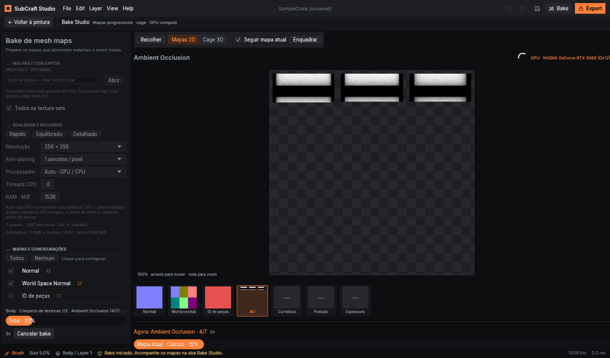
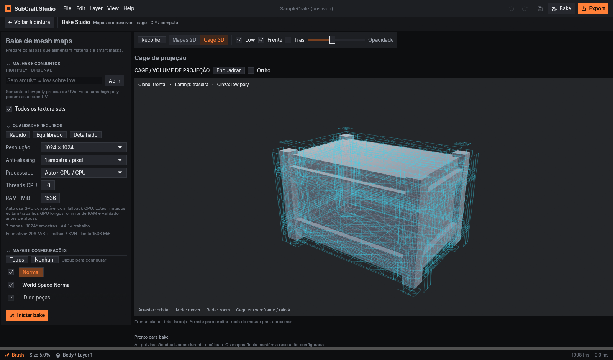

# Bake Studio

O bake agora tem uma aba própria. Abra com **Ctrl+B** ou pelo comando de bake e mantenha as configurações, a prévia dos mapas e a cage no mesmo espaço.

A aba abre ampliada. **Voltar à pintura** restaura o espaço de pintura, e **Recolher / Expandir** permite usar o bake junto dos painéis existentes sem perder seu layout.

## Fluxo de trabalho

1. Importe o **low poly com UVs**. O high poly é opcional e pode estar sem UVs.
2. Na aba de bake, selecione o high poly, se houver, e escolha todos os texture sets ou apenas o selecionado.
3. Defina resolução, anti-aliasing, processador e mapas desejados. Os presets **Rápido**, **Equilibrado** e **Detalhado** ajustam resolução e amostras.
4. Clique no nome de um mapa para configurar seus parâmetros. Use **Cage 3D** para ajustar a projeção antes do cálculo.
5. Clique em **Iniciar bake**. A aba mostra o conjunto em processamento, o mapa atual, a etapa, o tempo decorrido e o progresso.

**Mapas 2D** exibe prévias dos dados que o worker já calculou. As texturas são construídas durante o bake; não é uma animação de progresso sobre uma imagem final. **Seguir mapa atual** troca a visualização automaticamente, e as miniaturas permitem consultar os outros mapas do conjunto atual. Use a roda para zoom, arraste para mover e clique em **Enquadrar** para restaurar a vista.

As prévias têm resolução limitada e atualização controlada para manter a interface responsiva. Os resultados finais mantêm a resolução configurada. Ao trocar de texture set durante um bake de vários conjuntos, as prévias passam a representar o conjunto em processamento.

## Parâmetros dos mapas

| Mapa | Configuração e uso |
| --- | --- |
| Normal | Convenção OpenGL (+Y) ou DirectX (verde invertido); normal em espaço tangente do low poly. |
| World Space Normal | XYZ codificado em RGB no espaço da malha; utiliza os controles comuns de resolução e projeção. |
| ID de peças | Semente da paleta; uma cor estável por peça para seleções. |
| Ambient Occlusion | Amostras e distância dos raios; alimenta sombreamento e máscaras de cavidade. |
| Curvatura | Raio da vizinhança; cinza indica plano, claro indica convexo e escuro indica côncavo. |
| Posição | XYZ normalizado aos limites do low poly; utiliza resolução e projeção comuns. |
| Espessura | Amostras e distância dos raios internos; regiões finas aparecem mais claras. |

Os controles comuns incluem **Frente**, **Trás** e **Ray bias**. Frente e trás são frações da diagonal do low poly; por exemplo, `0,01` corresponde a 1% dessa diagonal. Ray bias, alcance de AO/espessura e raio de curvatura usam a maior diagonal entre low e high poly.

## Cage 3D

O wireframe frontal aparece em **ciano**, o traseiro em **laranja** e o low poly em **cinza**. A cage é extrudada pelas normais do low poly, usando a mesma escala dos raios de projeção. Você pode exibir cada parte separadamente e ajustar a opacidade.

Arraste para orbitar, use o botão do meio para mover e a roda para zoom. **Enquadrar** inclui o alcance da cage; **Ortho** alterna a projeção da vista. A cage aparece em raio X para facilitar a leitura. Em malhas grandes, somente o wireframe de visualização é simplificado; o bake usa a malha completa.

## GPU, CPU e limites

- **Auto · GPU / CPU:** tenta o backend GPU compatível e informa quando precisa usar CPU.
- **GPU:** solicita aceleração explicitamente; indisponibilidade ou limites do backend são reportados como erro, sem troca silenciosa por CPU.
- **CPU:** usa o backend CPU com o limite de threads configurado.

O backend GPU calcula os raios e mapas por compute. Importação, preparação de geometria/UVs, BVH, padding e aplicação dos resultados ainda podem usar CPU. A velocidade depende da GPU, da malha, dos mapas e da resolução; o modo GPU não implica um ganho fixo.

O dispositivo e o shader são inicializados em background e reutilizados nos bakes seguintes. Os buffers de trabalho são reutilizados entre mapas. A projeção do high poly é calculada uma vez quando cabe no orçamento do cache, evitando repetir os mesmos raios nos sete mapas.

A geometria GPU tem orçamento conservador de **512 MiB**. Cada buffer respeita o limite do adaptador, com teto de **256 MiB**; malhas que excedam esses limites precisam de CPU ou redução de geometria. A preparação também valida o custo temporário de serialização da geometria no orçamento de RAM.

**Threads CPU = 0** escolhe metade dos processadores lógicos disponíveis, com mínimo de um e máximo de quatro workers. É possível ajustar o limite manualmente. O controle **RAM · MiB** valida a estimativa dos buffers de bake antes da alocação; o padrão é **1536 MiB**. Memória das malhas/BVH, do documento e do driver é adicional à estimativa mostrada.

Resolução e anti-aliasing têm limites validados. A GPU trabalha em lotes limitados, e **Cancelar bake** solicita interrupção nos próximos pontos de cancelamento. Os mapas de um conjunto são aplicados ao documento após sua conclusão.

Esses limites reduzem a pressão sobre CPU, RAM e GPU. Estabilidade também depende do driver e do hardware; não há garantia contra falhas do sistema operacional.

## Validação desta atualização

Testes focados: 17 de bake, 2 de job em background, 2 do backend GPU real e 3 de interface/fallback/cage. Cobrem comparação numérica CPU/GPU nos sete mapas, AO com oclusor, high poly com os arrays de UV/tangentes removidos, falhas de projeção, anti-aliasing, normal DirectX, prévias reais, limites de memória, cancelamento e layout compacto. Não são testes de estresse.

Medições pontuais na **NVIDIA GeForce RTX 3060 / Direct3D 12**, Rust 1.99, perfil de teste otimizado, CPU limitada a quatro workers, sete mapas, AO 32 e espessura 16:

| Exemplo | CPU | GPU |
| --- | ---: | ---: |
| 128², high poly com 4032 triângulos | 129 ms | 138 ms |
| 256², high poly com 16256 triângulos | 650 ms | 593 ms |

No segundo exemplo, o ganho foi aproximadamente **1,10×**. No menor, a CPU foi ligeiramente mais rápida. Tempos incluem preparação UV e padding, mas excluem importação, construção da BVH e inicialização do dispositivo/shader. Não representam um ganho fixo nem equivalência ao Substance Painter.

Comandos para repetir apenas as verificações relevantes:

```powershell
. .\scripts\use-local-toolchain.ps1
cargo test -p subcraft-bake --lib -- --test-threads=1
cargo test -p subcraft-app --test bake_job -- --test-threads=1
$env:SUBCRAFT_REQUIRE_GPU = '1'
cargo test -p subcraft-bake-gpu --lib -- --test-threads=1
cargo test -p subcraft-bake-gpu small_hardware_benchmarks -- --ignored --nocapture --test-threads=1
cargo test -p subcraft-ui --lib baking_workspace -- --test-threads=1
cargo test -p subcraft-ui --lib forced_gpu_reports -- --test-threads=1
cargo test -p subcraft-ui --lib cage_extrusion -- --test-threads=1
```

O modo nativo `--bake-demo --screenshot arquivo.png` captura a construção real dos mapas. `--bake-demo-final` aguarda a conclusão de todos os mapas/conjuntos; `--cage-view` captura a cage. São verificações feitas pelo próprio aplicativo, sem automação do mouse ou teclado.

O executável portátil concluiu os sete mapas de dois conjuntos do exemplo em **1,8 s**, usando a RTX 3060 por Direct3D 12. Esse teste inclui inicialização do backend e serve como conferência do fluxo nativo, sem representar tempo de assets de produção.




